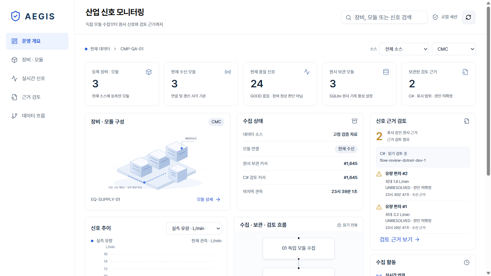

# Aegis Insight

## 모듈 생존·유한 복구 — 2026-11-09

Python 모듈 분리 수집에서 내부 작업 종료와 살아 있는 무응답 worker를 감지하고 해당 모듈만
유한 복구합니다. 정상 무데이터·긴 폴링 대기와 구분하고 기존 원본/커서를 유지합니다.
[설계·실제 Linux 합성 시험·운영 한계](docs/COLLECTOR_LIVENESS_RECOVERY_20261109.md).
실제 장비와 Windows 서비스 검증은 별도로 남아 있습니다.

후속으로 시작 설정 pipe가 막히는 구간의 감시·안전한 중단을 보완했습니다.
[설정 전송 복구와 검증 범위](docs/STARTUP_CONFIG_RECOVERY_20261109.md)를 확인하세요.

저장 용량 실패는 `ARCHIVE_FULL` 사유로 구분하고 연결/저장 사유 전환의 이벤트 누락을
보완했습니다. [실제 SQLite 장애 주입과 원본·커서 보전](docs/STORAGE_FAILURE_INTEGRITY_20261109.md).

출처 선언과 수집 방식은 opt-in health 정보에서 별도로 구분합니다. 기본 응답은 유지하며,
실제 장비 지원·과거 행의 출처 증명은 포함하지 않습니다.
[현재 계약, 검증 범위와 단계별 이행](docs/SOURCE_CONTEXT_CONTRACT_20261109.md).

원본 replay archive의 관찰 태그 사전과 기간·태그별 과거 조회를 별도 backend API로 제공합니다.
device/run을 명시하는 제한된 조회이며 큰 run은 부분 성공 없이 거부합니다.
[계약·조회 한도·원본 보전 검증](docs/RAW_HISTORY_20261109.md).

후속으로 raw 조회의 극단 UTC 변환 오류를 검증 오류로 처리했습니다.
[UTC 경계 회귀와 실제 모듈 IPC의 합성 검증](docs/RAW_QUERY_UTC_IPC_20261109.md).

범용 숫자 tag의 설정형 상·하한은 별도 읽기 전용 archive 분석 CLI로 제공합니다.
규칙 버전·적용 설정·근거를 기록하고 결측·불량·오래된 값은 평가 불가로 구분합니다.
[설정형 규칙·평가 기준·검증 범위](docs/NUMERIC_LIMIT_RULES_20261109.md).

선택 `--rule-lock`으로 같은 규칙 ID·버전의 내용 충돌과 미등록 버전을 조회 전에 거부합니다.
[기준 생성·버전 추가·재현과 신뢰 경계](docs/RULE_VERSION_LOCK_20261109.md).

수집 중 WAL archive를 고정된 시점으로 백업하고 보관한 manifest로 새 파일 복원을 검증하는
별도 CLI를 추가했습니다. 기존 대상은 덮어쓰지 않으며 자동 삭제나 실행 중 원본 전환은 없습니다.
[백업·복원 절차, 장애 결과와 검증 범위](docs/ARCHIVE_BACKUP_20261109.md).

읽기 전용 저장 진단 CLI는 원본·명시한 백업의 크기, 볼륨 여유와 보존 검토 정책을 보고합니다.
수신 시각 나이와 마지막 commit 측정값을 구분하고 정책 미설정·측정 불가·임계 초과를 명시합니다.
[진단 절차·SQLite 읽기 경계·운영 한계](docs/STORAGE_DIAGNOSTICS_20261109.md).

독립 어댑터 입력 계약은 별도 합성 replay CLI에서 원본 메타데이터의 제공/누락과 재전송을 검증합니다.
기존 SIMULATOR 수집·저장에는 연결하지 않으며 새 검증 cursor는 메모리 제안값입니다.
[입력 스키마·출처·timeout·보존 경계와 후속 이행](docs/ADAPTER_INPUT_20261109.md).

## Retained-summary investigation — 2026-11-06

Freeze a contextual investigation, inspect exact UTC/null rows with native keyboard controls and resume following the stream. This is a maximum-120-row memory UI view, not archive/raw-signal recovery. UI tests **25 passed**; actual browser freeze/keyboard/mobile checks passed, idle chart clears were 3 → 0 in the same 3.3 s scenario, and isolated points remain visible. [Implementation, evidence and limits](docs/COMPETITIVE_DEPTH_20261106.md).

노이즈가 많은 장비 신호에서 짧은 변화를 보존하고 판단 근거를 검토하는 로컬 개발 프로젝트입니다. CMP의 CMC·PMC·스케줄러 같은 모듈을 독립 프로세스로 수집하고, 수백 개 숫자 태그의 원본을 SQLite에 기록합니다. React·TypeScript의 밝은 화면을 ASP.NET Core·SignalR·Windows WebView2에 결합했습니다.

**범위:** 합성 에뮬레이터를 이용한 개발용 프로토타입입니다. 실장비 연결, 고객 데이터, 현장 성능 검증, 판매 실적은 포함하지 않습니다. 개발용 EWMA는 점검 참고이며 학습된 고장 예측 모델이 아닙니다.

위 화면은 **UI 검증용 고정 자료(FIXTURES)** 입니다. 실제 연결·현장 성능의 증거가 아닙니다. 좁은 창에서는 재배치하고, 전체 신호 목록은 상세 화면에서 확인합니다.

## 최신 실행과 검증

Windows PowerShell 7+, Python 3.12, .NET SDK **10.0.401**, Node.js **22.18+**, pnpm **10.17.1**이 필요합니다.

~~~powershell
.\scripts\setup.ps1
.\scripts\verify.ps1
.venv\Scripts\python.exe scripts\run_hybrid_demo.py --count 3 --scenario NOISY-FLOW
~~~

설정 스크립트는 글로벌 도구를 설치하지 않습니다. Release 빌드 후 실행하며, 종료해도 원본은 남습니다. [하이브리드 실행·검증 안내](docs/HYBRID_DASHBOARD.md).

**2026-10-31:** UI 로직8개·에뮬레이터26개·게이트웨이 내부41개·선택된 C# 및 창 정책47개가 통과했습니다. UI와 .NET Release 빌드도 통과했습니다. Python 전체는 **300개 중257통과·43실패**이며 표준 .NET 테스트와 실제 서버 통합은 Windows 소켓 오류10014로 중단됐습니다. 모든 검사를 통과한 상태가 아닙니다. [검사 요약](docs/evidence/hybrid-checks-2026-10-31.json).

ONNX 추론은 검증된 모델이 없어 `NOT_REGISTERED`입니다. PostgreSQL 이전과 실장비 보정은 완료로 표시하지 않습니다. signed-window 조합은 160개 합성 사례에서 기존 방식이 놓친 펄스28개를 추가 포착했지만 노이즈 후보가 늘어 적용 기준을 실패했으므로 런타임에 넣지 않았습니다. [동결 평가 결과](docs/evidence/signal-combination.json).

## 이전 증거와 설계 자료

현재 우선순위는 **노이즈 속 실제 공정 변화의 보존과 구분 근거**입니다. [신호 검토 설계·재현·한계](docs/SIGNAL_REVIEW.md)에서 원본/파생 추세/미해결 검토 기록과 검증 결과를 확인하세요. 현장 원인 분류가 완성된 상태는 아닙니다.

2026-10-20 전체 로컬 검증은 Python280개 통과·6개 프로세스 시험 실패이며, 신규 신호 검토38개는 통과했습니다. 에뮬레이터26개·.NET74개와 Release 빌드는 통과했습니다. [현재 실패를 포함한 검사 기록](docs/evidence/signal-review-checks/summary.json). 아래248개 별도 설치 검증은 이전 버전의 재현 증거입니다.

[START_HERE.md](START_HERE.md)에서 실행 순서를 확인하고, [포트폴리오 사례](docs/PORTFOLIO.md)에서 설계와 증거를 살펴보세요. [실제 화면 GIF·데모 가이드](docs/DEMO_GUIDE.md), [병목과 개선 전후 측정](docs/PERFORMANCE.md), [구현·시험 상세](docs/DURABLE_INGESTION_REPORT.md)를 함께 제공합니다.

[별도 설치 폴더 검증](docs/REPRODUCIBILITY.md): Python **248개**, 독립 에뮬레이터 **25개**, .NET **74개** 통과와 Release 빌드를 확인했습니다. 이는 로컬 결과이며 원격 CI 배지는 사용하지 않습니다.

## 로컬 실행

Windows의 PowerShell 7 이상에서 Python 3.12와 저장소에 고정된 .NET SDK 10.0.401을 준비합니다. Python 경로가 자동 검색되지 않으면 설치된 실행 파일 경로를 넘깁니다.

~~~powershell
.\scripts\setup.ps1
# 필요할 때만:
.\scripts\setup.ps1 -PythonPath "C:\Path\To\Python312\python.exe"
.\scripts\verify.ps1
.venv\Scripts\python.exe scripts\run_emulator_demo.py --isolate --count 3 --scenario DATA-QUALITY --seconds 70
~~~

verify는 계약 검사, Python·에뮬레이터 시험, .NET Release 빌드와 시험을 실행합니다. Release 빌드가 끝난 뒤 데모 명령을 실행하세요. 데모가 종료되어도 원시 데이터베이스는 보존되며, 실행 로그에서 경로를 확인할 수 있습니다. 이 안내는 로컬 실행 방법이며 원격 CI가 실행됐다는 뜻은 아닙니다.

## 코드와 증거

- 수집 계약·페이지 검증: [collector.py](src/aegis/collector.py)
- 트랜잭션 저장·커서·중복 처리: [archive.py](src/aegis/archive.py)
- 모듈 프로세스 경계와 요약 검증: [module_worker.py](src/aegis/module_worker.py), [processes.py](src/aegis/processes.py)
- 품질 검사와 개발용 EWMA: [evaluation.py](src/aegis/evaluation.py)
- 화면과 API 연결: [DesktopApiClient.cs](src/Aegis.Desktop/DesktopApiClient.cs), [MainWindow.xaml.cs](src/Aegis.Desktop/MainWindow.xaml.cs)
- 저장·재생 회귀 사례: [test_archive.py](tests/test_archive.py), [test_replay_collector.py](tests/test_replay_collector.py)

설계 선택, 시험 범위, 알려진 한계와 인터뷰 토론 주제는 [docs/PORTFOLIO.md](docs/PORTFOLIO.md)에 정리했습니다.
