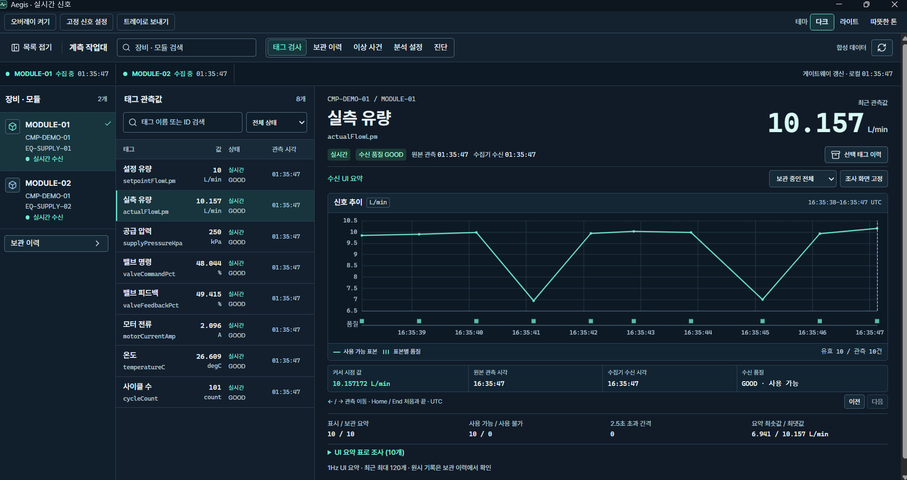
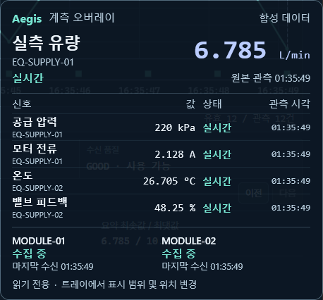

# Aegis Insight

**Windows에서 장비 신호의 수신·품질·추세를 보고, 이상이 발생한 시점의 원본까지 확인하는 읽기 전용 계측 작업대입니다.** 여러 모듈의 상태를 한 화면에 모아 보고, 다른 업무 중에는 필요한 신호만 오버레이에 고정할 수 있습니다.

[Windows 실행과 설치](scripts/windows_release/README.ko.md) · [시연 흐름과 검증 범위](docs/PORTFOLIO_WINDOWS.md) · [동반 모드](docs/WINDOWS_COMPANION.md)

*최대화한 Windows 작업대, OS 배율 125%. 두 개의 로컬 합성 수집기가 보내는 신호입니다.*

### 읽기 전용 오버레이

장비를 조작하는 화면을 사용하는 동안에도 Aegis에서 고정한 신호의 값과 시각을 확인할 수 있습니다. 오버레이를 켰을 때 작업대가 전경을 유지하는 동작을 Windows에서 확인했습니다. [작업대와 오버레이를 함께 연 화면](docs/images/windows-workbench/aegis-workbench-with-overlay.png)

### 주요 작업

- **수집 상태 확인.** 모듈별로 실제 값 0, 누락, 오래된 값, 다시 불러온 이력을 구분합니다. 선택 태그의 시각과 추세를 확인하고 원본 이력을 엽니다.
- **사건 조사.** 경고의 근거 신호를 확인하고 운영자 확인을 남깁니다. 앱을 다시 열어 같은 사건과 이전 세션의 원본을 찾아볼 수 있습니다.
- **이력 분석과 진단.** 합성 보관 기록에서 유량 예측 방식의 오차를 비교하고, 상태와 건수만 담은 진단 JSON을 로컬에 저장합니다. 현장 고장 탐지와 학습 모델의 실시간 적용은 별도로 검증할 범위입니다.

## 실행과 검증

[Windows x64 포터블 ZIP](https://github.com/KIMJINWOO0548/Aegis/releases/latest)을 로컬 폴더에 풀고 마이크로소프트 Edge WebView2 Runtime이 준비된 PC에서 `Aegis.cmd`를 실행합니다. 합성 수집기 두 개로 수신·보관·작업대를 확인할 수 있습니다. [실행, 저장 위치, 사용자별 설치 안내](scripts/windows_release/README.ko.md).

현재 브랜치의 검사 결과는 [Windows CI](https://github.com/KIMJINWOO0548/Aegis/actions/workflows/windows-ci.yml?query=branch%3Amain)와 [Linux 보관 CI](https://github.com/KIMJINWOO0548/Aegis/actions/workflows/posix-archive-ci.yml?query=branch%3Amain)에서 확인할 수 있습니다. 날짜별 개발 결과와 이전 하이브리드 실행 절차는 [이전 개발 및 검증 기록](docs/DEVELOPMENT_HISTORY.md)에 있습니다.

실제 설비 연결은 검증하지 않았습니다. 합성 어댑터의 Windows 저장은 신뢰할 수 있는 로컬 NTFS 경로를 지원합니다. 보관 도구의 지원 범위와 저장 제한은 [Windows 어댑터 검증](docs/WINDOWS_ADAPTER_STORE_20261116.md)과 [플랫폼 사전 확인](docs/GAMJA_RECONCILIATION_20261116.md)을 참고하세요.

## 코드와 증거

- 수집 계약·페이지 검증: [collector.py](src/aegis/collector.py)
- 트랜잭션 저장·커서·중복 처리: [archive.py](src/aegis/archive.py)
- 모듈 프로세스 경계와 요약 검증: [module_worker.py](src/aegis/module_worker.py), [processes.py](src/aegis/processes.py)
- 품질 검사와 개발용 EWMA: [evaluation.py](src/aegis/evaluation.py)
- 화면과 API 연결: [DesktopApiClient.cs](src/Aegis.Desktop/DesktopApiClient.cs), [MainWindow.xaml.cs](src/Aegis.Desktop/MainWindow.xaml.cs)
- 저장·재생 회귀 사례: [test_archive.py](tests/test_archive.py), [test_replay_collector.py](tests/test_replay_collector.py)

설계 선택, 시험 범위, 알려진 한계와 인터뷰 토론 주제는 [docs/PORTFOLIO.md](docs/PORTFOLIO.md)에 정리했습니다.
