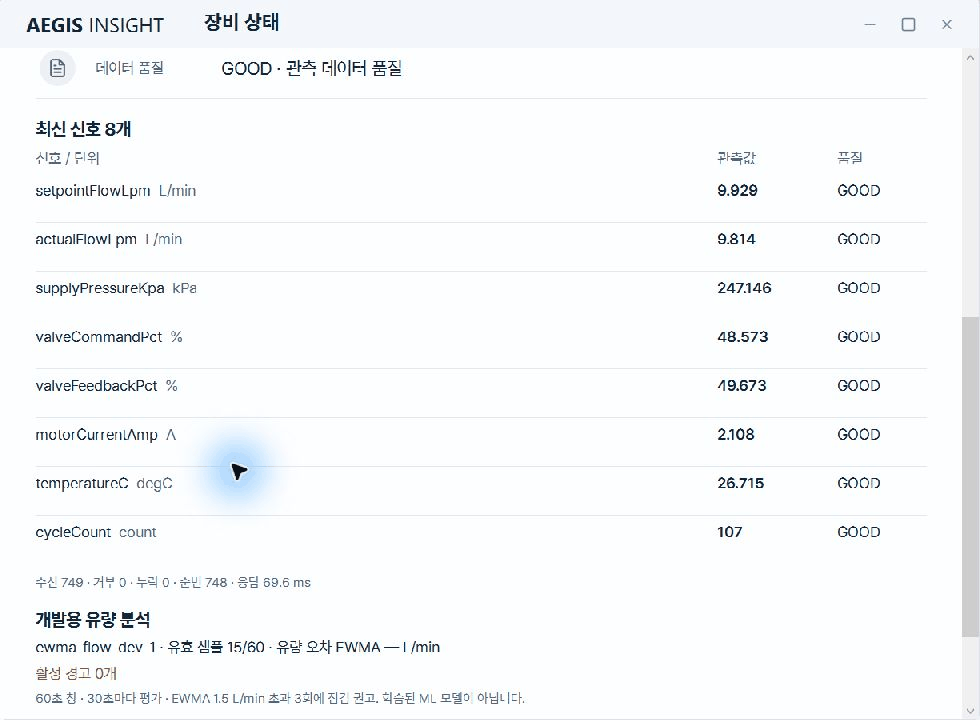

# 데모 가이드: 60–90초 검토 흐름

합성 에뮬레이터와 실제 WPF를 실행해 캡처한 [12초 GIF](evidence/portfolio/demo-data-quality.gif)를 제공합니다. GOOD·준비 중 → 결측 → 유량−5 범위 오류 → GOOD·준비 중 순서로 실제 캡처3장을 재배치한 단계별 재생이며 연속 화면 녹화나 시간 지연 측정 자료는 아닙니다. 아래60–90초 구성안은 직접 녹화할 때 사용할 수 있습니다.

[이전 기능 검증의 센서 BAD 화면](evidence/emulator-fault-desktop-details.png), [이번 시연의 일시 수집 지연·STALE 화면](evidence/portfolio/demo-frames/record-05.png)도 제공합니다. 이번 시연의 접근성 텍스트와 캡처 시각은 [캡처 목록](evidence/portfolio/demo-frames/captures.json)과 같은 폴더에 있습니다. GIF에 사용한 이미지의 값·문구를 합성하지 않았으며 상태 GOOD은 신호 품질을 뜻하고 장비 정상 판정이 아닙니다.

종료 후 원시 DB 검사에서3개 모듈의256신호 자료, 원시 순번 연속성·무결성과 첫 모듈의 GOOD/MISSING/BAD/GOOD−5 구간을 확인했습니다. [시연 원시 기록 검사](evidence/portfolio/demo-observations.json). 일시 POLL_TIMEOUT도 관측했으므로 이 시연을 안정성·지연 보증으로 해석하지 않습니다.

## 실행

Windows·PowerShell 7 이상에서 Release 빌드가 끝난 뒤 실행합니다. verify.ps1도 Release 빌드와 시험을 포함합니다.

~~~powershell
.\scripts\setup.ps1
.\scripts\verify.ps1
.venv\Scripts\python.exe scripts\run_emulator_demo.py --isolate --count 3 --scenario DATA-QUALITY --seconds 70
~~~

원시 SQLite 파일은 데모 종료 뒤에도 보존됩니다. 실제 경로는 실행 로그에서 확인합니다. DATA-QUALITY 시나리오는 에뮬레이터 시작을 기준으로 60초 주기를 반복합니다. API와 WPF가 뜨기 전에 에뮬레이터 주기가 시작되므로 화면에서 보이는 구간은 아래 시간과 어긋날 수 있습니다. 영상 시간에 대한 정확한 동기화로 말하지 말고 원시 관측 시각과 순번으로 확인하세요.

## 화면 녹화 스토리보드

| 영상 흐름 | 소스 시작 기준 | 보여줄 내용 |
|---|---:|---|
| 0–10초 | 시작 | 세 에뮬레이터와 모듈 연결 상태, 관측 데이터 시각을 보여주고 로컬 합성 시험임을 밝힙니다. |
| 10–25초 | 0–15초 정상 구간 | 연결됨·GOOD 상태의 신호를 확인합니다. 창이 늦게 떴다면 UI가 이미 다음 단계일 수 있으므로 DB에서 정상 행을 확인합니다. |
| 25–38초 | 15–30초 | 결측/null 구간입니다. 품질 상태와 최신 관측 시각을 확인합니다. |
| 38–51초 | 30–45초 | BAD/null 구간입니다. 화면에서 유효하지 않은 입력과 점검 사유가 정상 판정을 막는지 확인합니다. |
| 51–64초 | 45–60초 | 원본 품질은 GOOD이지만 실제 유량이 -5인 구간입니다. 원시 값은 유지되고 평가에서 범위 오류가 표시되는지 확인합니다. |
| 64–85초 | 반복 확인 | 실행 로그의 SQLite 경로를 열어 raw_batches의 sequence, observed_at_utc, quality, value가 네 구간을 보존하는지 보여줍니다. 필요하면 GET /v1/ingestion의 저장 커서와 데이터 나이를 함께 확인합니다. |

시나리오 단계의 기준 시각은 에뮬레이터 프로세스 시작 시점입니다. WPF 연결 시점이 늦으면 정상 구간을 지나친 화면만 보일 수 있습니다. 그 경우 기록된 원시 데이터베이스에서 각 phase의 시각과 값을 확인하세요. 화면만 보고 각 15초 구간이 실시간으로 표시됐다고 단정하지 않습니다.

## 검토자가 확인할 점

- 결측과 BAD 입력이 최신 정상으로 보이지 않고 평가 불가 또는 점검 상태로 전달되는지
- -5 원시 값과 품질이 기록에서 그대로 남고, 평가 결과에 OUT_OF_RANGE 사유가 붙는지
- 화면의 API 조회가 원시 전체 이력 대신 최신 요약을 표시하는지
- 저장 커서가 마지막 커밋 sequence와 맞는지

이 시연은 합성 값의 기능 확인입니다. 실장비 정확도, 설치 안정성, 장시간 처리량을 증명하지 않습니다. 코드 수준의 잠금·디스크 가득 참·재시도 확인은 [저장 시험](../tests/test_archive.py)과 [재생 시험](../tests/test_replay_collector.py)에 있습니다.
