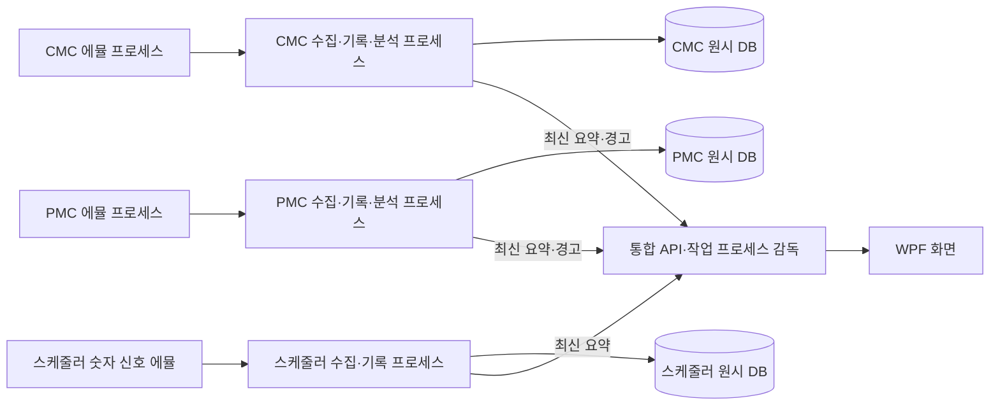

# 모듈별 원시 기록과 프로세스 분리

이 보고서는 첫 내구 수집 개발의246개 Python 검증과 당시 부하 기록을 보존한다. 후속 직렬화 개선·반복 측정은 [성능 보고서](PERFORMANCE.md), 새 폴더에서248개를 확인한 결과는 [재현 보고서](REPRODUCIBILITY.md)를 참고한다.

2026-10-18~19. 사용자가 요청한 이상 값 대응, 수백 개 신호, CMC·PMC·스케줄러 단위 분리와 짧은 변화 보존을 위한 로컬 합성 데이터 개발 범위다. 실제 장비 구성·수집 주기는 요청하지 않았으며 고객 자료를 사용하지 않았다.

## 실행 구조



장비 아래 모듈을 `equipmentId`와 `moduleId`로 구분한다. 각 논리 소스는 고유 ID·포트·프로세스·저장 위치·수집 커서를 가진다. 프로세스는 모듈이나 책임 단위로 생성하며 태그마다 생성하지 않는다. 통합 API에는 원시 수백 개 태그 대신 기존 8개 유량 프로필의 최신 값·품질·통계·경고를 전달한다.

모듈별 SQLite 파일을 분리해 한 모듈의 writer 잠금이 다른 모듈의 writer를 잡지 않도록 한다. 프로세스 분리는 CPU 작업과 장애를 분산하지만 전체 기록량·디스크 대역폭·메모리를 없애지 않는다. SQLite WAL도 DB별 writer는 하나이며 FULL 동기화·체크포인트 비용이 있으므로 측정이 필요하다. [SQLite WAL](https://www.sqlite.org/wal.html), [synchronous 설정](https://www.sqlite.org/pragma.html#pragma_synchronous).

## 짧은 변화와 이상 값

- 기존 `/v1/snapshot` 프로토콜1.0·8개 신호를 유지했다. 새 `/v1/batches`는 프로토콜1.1 숫자 신호를 스냅샷당 최대512개 받는다. 임의 태그 식별자를 지원하므로 태그마다 기존 유량 enum에 항목을 추가하지 않는다.
- 페이지는 최대256개 스냅샷·900000바이트, 소스 재전송 구간은 최근4096개 순번이다. 수집기는 최대1MiB와 전체 HTTP 응답 제한을 적용한다. 밀린 페이지는 정규 조회 간격을 기다리지 않고 처리하되 소스당 요청은 하나다.
- `deviceId/runId/sequence`, 원래 시각·품질·값, 수신 UTC, 장비·모듈 식별자를 원시 DB에 저장한다. 배치·누락 구간·커서를 하나의 트랜잭션으로 기록한 뒤에만 화면/분석에 공개한다. 같은 ID 재시도는 중복 저장하지 않고, 같은 ID에 다른 값이 오면 거부한다.
- 저장 잠금·디스크 가득 참·commit 실패에서는 커서를 유지한다. 재시작 후 저장된 커서에서 이어받는다. 재전송 보존 구간을 넘으면 누락 순번 범위를 별도로 기록한다. 무제한 무손실을 보장하지 않는다.
- `DATA-QUALITY`: 결측/null → BAD/null → 소스 GOOD지만 유량−5. 원시 증거는 바꾸지 않고 진단에서 BAD/점검 사유를 표시한다. `TRANSIENT`: 매초100ms 동안 유량−5. 화면보다 빠른10ms 표본도 원시 DB에 보존한다.
- `DEG-02`: 유량 목표10L/min, 실제 유량이60초 이후 점차 감소한다. 개발용 EWMA는 유효 입력을1Hz로 투영해60표본/30초 평가, alpha0.2,1.5L/min 초과3회로 경고,1.0 이하3회로 복구한다. 버전은 `ewma-flow-dev-1`, ADVISORY이며 장비 보정이나 학습 모델이 아니다.
- 결측·BAD·범위 오류는 분석 창을 초기화한다. 운전 모드와 상태 버전 변경도 새 창을 시작한다. 과거 재전송 자료는 저장하지만 실시간 경고·복구를 만들지 않으며, 오래된 데이터는 STALE/UNAVAILABLE이다.

## 실행

```powershell
dotnet build Aegis.slnx --configuration Release
.venv/Scripts/python.exe scripts/run_emulator_demo.py --isolate --count 3 --signal-count 256 --interval-ms 100 --scenario TRANSIENT --seconds 60
```

이 명령은 합성 에뮬레이터3개, 독립 작업 프로세스3개, 통합 API와 WPF를 실행한다. 일회용 인증 토큰은 환경변수로 전달하고 출력하지 않는다. 원시 DB 경로는 실행 메시지에 표시하며 데모 종료 후에도 보존한다. `--archive`로 데모 보관 폴더를 지정할 수 있다. 일반 데모 기본값은256개 신호·100ms 표본이며, `--isolate`가 없으면 비교용 단일 수집/API 프로세스를 사용한다.

수동 실행: [CMP 구성 예제](../config/cmp.example.json)의 소스 ID와 각 에뮬레이터의 `--device-id`를 일치시킨다. 에뮬 프로젝트에서 각각 `--signal-count 256 --interval-ms 100`을 사용하고, Aegis 루트에서 아래 명령으로 통합한다. API와 에뮬레이터 토큰 환경변수 설정은 [최초 연결 보고서](EMULATOR_LINK_REPORT.md)를 참고한다.

```powershell
.venv/Scripts/python.exe -m aegis.api --emulators config/cmp.example.json --isolate --archive-directory runtime/modules --evaluate
```

`GET /v1/ingestion`에는 모듈 식별자, 신호 수, 저장 완료 순번, 마지막 원시 관측 UTC(`lastObservedAtUtc`), 저장 지연, 데이터 나이, 대기 배치, 작업 PID·재시작 수를 표시한다. 유량 태그가 없는 모듈도 분석기 시작 시각 대신 원시 관측 시각으로 신선도를 판단하며, 지연된 프로세스 메시지 수신이 오래된 원시 자료를 새 자료로 만들지 않는다. 기존 `/connections`, `/observations`, `/health`, `/diagnostics`, `/warnings`는 호환을 유지한다. 새 로컬 에뮬레이터 확장 경로는 기존 thin-demo YAML 자체에 추가하지 않았으며 별도 설계에 명시했다.

## 검증 증거와 한계

실제 별도 프로세스 시험은 [일반 재시작·재전송](evidence/replay-integration.json), [모듈 장애·감독 프로세스 종료](evidence/module-processes.json), [결측·센서 오류·범위 오류](evidence/emulator-fault-response.json)에 기록했다. 테스트는 실제 SQLite 잠금, SQLITE_FULL, commit rollback, 커서 복구, 변경된 중복 ID 거부, 과거 자료의 경고·복구 차단도 검사한다.

작업 종료/프로토콜 오류는 해당 모듈만 재시작한다. 요약이 끊기거나 원래 관측 시각이 오래되면 GOOD을 유지하지 않는다. 통합 프로세스가 갑자기 종료되면 stdin 수명 파이프 EOF로 작업 프로세스가 종료된다. 현재는 전경 프로세스 트리이며, 통합 API와 무관하게 살아남는 Windows 서비스가 아니다.

종료 시 stdin을 닫고 5초 동안 기다린 뒤 응답 없는 소유 프로세스만 강제 종료한다. 재시작 PID가 생긴 직후에는 아직 Python 초기화 중일 수 있어 정상 종료 코드0을 보장하지 않는다. [초기화 지연 재현](evidence/worker-startup-shutdown.json)에서 5.02초 뒤 종료 코드1·잔존 프로세스0을 확인했다. 정상 종료 검증은 새 작업의 첫 요약 수신까지 확인하며 초기화 정지 경로의 정리도 별도로 검사한다.

원시 기록과 커서는 영구 보관하지만 EWMA 창·경고 목록·타임라인은 메모리 상태다. 재시작 후 EWMA는 다시 준비한다. 발생·복구·품질 변경 운영 이벤트는 별도 JSONL이며 원시 값을 INFO 로그에 중복 출력하지 않는다. 영구 ACK·일반 태그 탐색 화면·과거 Trend API는 미구현이다.

숫자 신호 이외의 문자열·스케줄러 이벤트 의미, 장비별 태그 사전·범위·레시피 매핑, 실제 통신은 별도 정의가 필요하다. 현재512개/논리 소스와32개 소스는 메모리/응답 경계이며 검증된 현장 용량이 아니다. 자동 보관 기간 삭제·압축·디스크 예산 정책은 없고 디스크 오류는 수집 실패로 드러난다. 백업 시 WAL을 포함한 일관된 SQLite 백업이 필요하다. 에뮬레이터 자체를 재시작하면 아직 보관하지 못한 이전 run 데이터는 재전송할 수 없다. 응답을 멈춘 채 살아 있는 작업 프로세스는 unavailable로 표시하며 자동 재시작 watchdog은 아직 없다.

최대 실시간성·전원 차단 내구성·장기 부하·32개 규모·하드웨어 보정은 이 결과로 보증하지 않는다. 짧은 로컬 부하 시험은 처리율·API 지연과 실제 데이터 나이를 함께 판단해야 한다.

## 최종 로컬 확인 — 2026-10-19

- Python 전체: `.venv/Scripts/python.exe -m pytest --junitxml=docs/evidence/emulator-python-tests.xml -q` → **246개 통과**,92.62초. Starlette/httpx의 상위 라이브러리 deprecation 경고1개. [전체 시험 XML](evidence/emulator-python-tests.xml).
- 독립 에뮬 프로젝트: 해당 폴더에서 `python -m unittest discover -s tests -v` → **25개 통과**,9.382초. Aegis 패키지를 가져오지 않는 별도 프로젝트 검증이다.
- .NET Release 빌드: 경고0·오류0. `dotnet test Aegis.slnx --configuration Release --no-build` → **74개 통과**,실패/건너뜀0. [TRX](evidence/emulator-dotnet-results/김진우_감자_2026-10-19_19_46_16_net10.0.trx).
- 계약 생성물 drift와 v3.4 YAML/OpenAPI/샘플/reference SQL 검사가 통과했다. 원격 CI 실행이나 실제 제품 DB 검증을 뜻하지 않는다.
- 최종 확인에서 이 작업의 API·모듈·에뮬 Python 프로세스는 남아 있지 않았다. 원시 데모 DB는 보존한다.

사용자가 설치한 `codex-auto-model-router` 기본 balanced 경로를 적용했다. `gpt-6-luna/high` 하위 에이전트가 IPC 검증을 구현했고, `gpt-6.1-sol/medium`의 독립 검토가 유량 태그 없는 모듈의 신선도 오류를 재현했다. 통합 검토에서8개 센서 issue 호환, 큰 정수 안전 거부, 지연된 raw-only 요약 처리를 수정하고 회귀 테스트를 통과했다. 주 대화 모델을 자동 전환한 것이 아니며, 실제 실행한 하위 모델만 [실행 기록](evidence/model-routing.jsonl)에 남겼다. 측정한 직렬 비교가 없으므로 라우터의 속도 향상이나 비용 절감을 주장하지 않는다.

## 기본 100ms 표본 측정

동일한 합성 신호256개, 모듈별 프로세스,100ms 표본·100ms 조회,3초 준비 후10초 측정이다. WPF와 EWMA는 제외한다. 이전 고속 시험과 별도 시점의 단회 측정이므로 개선 배수나 현장 용량을 의미하지 않는다.

| 모듈 수 | 기록한 값/초 | API p95 | 관측 데이터 나이 p95 | 관측 commit p95 | 종료 시 대기 배치 |
|---:|---:|---:|---:|---:|---|
| 1 | 2585 | 3.62ms | 347ms | 6.75ms | 0 |
| 4 | 10239 | 3.11ms | 354ms | 4.82ms | 모두0 |

종료 시 모든 모듈이 CONNECTED였고, 거부·확정 누락은0, DB 무결성과 저장 접두 구간 연속성 검사가 통과했다. 소유 프로세스도 모두 정리했다. 수집 표본이100ms라는 사실이 화면/통합 요약의 지연100ms를 뜻하지 않는다. 통합 요약은 작업 프로세스에서200ms마다 전달한다. 이 짧은100ms 조건에서는 계속 밀리지 않았지만 아래10ms 조건에서는 밀렸다.

원본: [기본 주기 측정](evidence/isolated-10hz-benchmark.json).

```powershell
.venv/Scripts/python.exe scripts/benchmark_emulators.py --replay --isolate --counts 1 4 --interval-ms 100 --seconds 10 --output docs/evidence/isolated-10hz-benchmark.json
```

## 고속 합성 부하 측정

Windows11, Python3.12.14, 논리 CPU8개. 모듈당256개 숫자 신호,10ms 표본(목표25600값/초/모듈),100ms 조회,3초 준비 후10초 측정, 규모별1회다. WPF·개발용 EWMA는 제외하며 SQLite WAL/FULL 원시 기록 비용은 포함한다. 일반 사용 중인 데스크톱에서 측정했고 시점별 다른 부하를 통제하지 않았다. 단일 방식과 분리 방식의 개선 배수를 보장하는 대조 시험이 아니다.

| 모듈 수 | 실행 | 기록한 값/초 | API p95 | 관측 데이터 나이 p95 | 종료 시 데이터 상태 |
|---:|---|---:|---:|---:|---|
| 1 | 단일 수집/API | 14255 | 353.3ms | 5.56초 | DISCONNECTED |
| 1 | 모듈별 프로세스 | 16486 | 15.4ms | 12.76초 | STALE |
| 2 | 단일 수집/API | 31794 | 214.5ms | 11.88초 | STALE |
| 2 | 모듈별 프로세스 | 29435 | 14.4ms | 20.19초 | STALE |
| 4 | 단일 수집/API | 26353 | 393.1ms | 13.35초 | STALE / DISCONNECTED |
| 4 | 모듈별 프로세스 | 45915 | 11.2ms | 21.48초 | STALE / DISCONNECTED |

분리 방식에서 통합 API 응답은 가벼웠으나 **이100Hz 기록 조건은 실시간 목표에 미달**했다. 4모듈 목표102400값/초보다 기록 처리율이 낮고 측정 중 대기량이 증가했다. 분리 방식4모듈은 통합 API CPU4.53%/코어, 작업 프로세스 합계94.66%/코어, API working set53.44MiB, 작업 합계265.44MiB였다. 낮은 API 지연을 전체 수집 지연으로 해석하면 안 된다.

검사한 저장 접두 구간은 연속되고 무결성 검사가 통과했으며, 이번 짧은 창의 확정 누락은0이었다. 종료 시 아직 받지 않은 소스 꼬리 구간은 모두 보관했다고 주장하지 않는다. 재전송 버퍼가 유한하므로 지연이 계속 증가하면 이후 overflow가 생긴다. commit 지연 수치는 관측한 서로 다른 완료 커서의 샘플이며 모든 트랜잭션을 별도 계측한 분포는 아니다.

원본: [단일 수집](evidence/replay-benchmark.json), [모듈별 프로세스](evidence/isolated-benchmark.json). 처음 연결만 확인했던8신호·1Hz 수치는 [최초 보고서](EMULATOR_LINK_REPORT.md)와 범위가 다르다. 기본100ms 표본과 고속10ms 표본을 혼동하지 않는다.

재실행(합성 자료만 생성):

```powershell
.venv/Scripts/python.exe scripts/benchmark_emulators.py --replay --counts 1 2 4 --seconds 10
.venv/Scripts/python.exe scripts/benchmark_emulators.py --replay --isolate --counts 1 2 4 --seconds 10
```

실제 WPF에서도 결측·BAD·유량−5의 BAD/OUT_OF_RANGE 점검 문구와 EWMA 평가 불가를 확인했다. [결측 화면](evidence/emulator-fault-desktop.png), [센서 오류 화면](evidence/emulator-fault-desktop-details.png), [범위 오류 화면](evidence/emulator-out-of-range-desktop.png)와 같은 이름의 접근성 텍스트가 증거다. 창 높이에 따라 아래 표·안내는 스크롤로 접근한다. 원래 시안과의 시각적 재감사는 하지 않았다.

로컬 시험 중 Windows 수신 소켓 시작 및 Python 이벤트 루프의 socketpair 생성에서 간헐적 WinError10014가 관측됐다. 집중 시험은 초기화 실패와 후속 미정리 루프 경고로 실패했고 동일 명령 재실행은55개가 통과했다. 전체 시험에서도 입력 검증 전 초기화 실패와 추가 작업 재시작이 관측됐다. 작업 stderr에 원래 OSError 번호가 없었으므로 이 두 실패가 같은10014인지는 추정이며, 앞으로는 민감한 설정 없이 예외 종류·번호를 남긴다. 독립 소켓/루프 생성 총800회에서는 재현되지 않았다. 원인이나 재발 방지를 확정하지 않는다. [실패 기록·진단 범위](evidence/windows-socket-startup-observations.json)와 [해당 전체 시험 XML](evidence/emulator-python-tests-runtime-failure.xml)을 보존했다. 앞서 수정한 Proactor WinError64와는 별도 관측이다.
