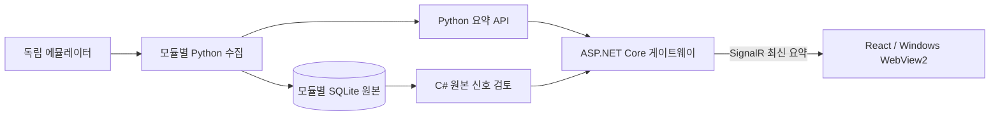

# 하이브리드 대시보드 실행과 검증

2026-10-31. React/TypeScript·Tailwind/shadcn·ECharts·React Flow·ASP.NET Core/SignalR·WebView2를 구현했습니다. Python 수집과 모듈별 SQLite 원본은 유지합니다. C# 검토는 개발용 통계 규칙이며 학습된 모델이 아닙니다.

## 실행

```powershell
.\scripts\setup.ps1
Push-Location ui
pnpm test
pnpm build
Pop-Location
dotnet build Aegis.slnx -c Release --no-restore
.venv\Scripts\python.exe scripts\run_hybrid_demo.py --count 3 --scenario NOISY-FLOW --seconds 120
```

Node.js22.18+와 pnpm10.17.1을 미리 준비합니다. 글로벌 도구·설정을 변경하지 않습니다. 기본256개 숫자 태그/모듈, 합성 샘플 간격50ms, 수집 폴링100ms는 실행 설정이며 지속 처리율 보장이 아닙니다. 첫 모듈만 지정한 시나리오를 쓰고 나머지는 NORMAL입니다. 원본은 새 `runtime/raw/hybrid-<id>/`에 남습니다.

Windows 화면은 같은 출처의 첫 문서 요청에만 접속 헤더를 전달합니다. 이후 요청은 HttpOnly 세션 쿠키를 사용합니다. 외부 탐색·프레임·팝업·다운로드·권한 요청을 막고 임의 host object를 노출하지 않습니다. 원래 WPF 화면도 연결 실패 안내에서 열 수 있습니다.

브라우저를 사용할 때는 현재 터미널에만 임의 토큰을 설정하고 `--headless`로 실행합니다. 토큰을 URL에 붙이지 마세요.

```powershell
$env:AEGIS_DASHBOARD_TOKEN = [Convert]::ToHexString([Security.Cryptography.RandomNumberGenerator]::GetBytes(32))
.venv\Scripts\python.exe scripts\run_hybrid_demo.py --headless --count 2 --seconds 120
# http://127.0.0.1:8780 에서 이 터미널의 토큰으로 접속
```

기존 WPF 재현은 `.venv\Scripts\python.exe scripts\run_emulator_demo.py --isolate --count 3 --scenario DATA-QUALITY --seconds 70`입니다. 두 Windows 화면 모두 시작 시 논리 작업 영역에 맞춥니다. 실제 다중 모니터·DPI 조합의 Windows 렌더링은 추가 검증이 필요합니다.

## 데이터 경계



C# 엔진은1Hz 화면 요약이 아니라 커밋된 원본을 순서대로 읽습니다. 한 번에64행×4페이지까지 읽고, 따라잡는 동안 맥락을 유지하되 현재 분석으로 표시하지 않습니다. 원본과 파생 추세를 분리하고 모든 편차 원인은 UNRESOLVED입니다. 최근32개 근거만 요약에 남으며 원본은 별도로 보존됩니다.

화면은 최대32모듈의8개 프로필 신호와 신호별120개 요약을 표시합니다. 원본 고속 파형 조회나 검증된 현장 용량을 뜻하지 않습니다. GOOD은 수집 품질이며 장비 정상 판정이 아닙니다. ONNX는 NOT_REGISTERED이고 PostgreSQL 이전·실장비 보정은 미완료입니다.

## 검증 범위

- UI: production 빌드와 데이터 로직8개 통과. Playwright의 UI 전용 FIXTURES로 접속 폼, 개요→전체 신호8개 행, 장비 전환, 압력 차트 선택, 검색 결과1개, 연결 중단 시 현재 필터가 비고8개 이력 행이 남는 동작을 확인했습니다. 최종 페이지의 콘솔 오류는0개입니다.
- 레이아웃:1366/1024/768/390px에서 페이지 가로 넘침 없음, 워크플로 세 노드가 컨테이너 안에 있음을 검사했습니다. 낮은 창은 세로 스크롤, 표는 자체 가로 스크롤을 사용합니다. 전체 화면을 축소해 글자를 작게 만들지 않습니다. 모바일 캡처 한 번은 타임아웃됐고 이후 모바일은 DOM 경계 검사로 확인했습니다.
- 게이트웨이: 실제 계약 형태의512개 원본 신호, 화면8개 제한, 잘못된 Host/Origin/단위/장비 ID, 세션, 읽기 전용 SQLite600개 커밋 프레임 재생, 페이지 경계 펄스, 새 run, 이력 보존 등41개 내부 검사 통과.
- 선택된 .NET: 기존 xUnit의 C# 엔진·접속 정책·작업 영역 시험47개를 동일한 기대값으로 프로세스 내부에서 실행했습니다. 표준 테스트 실행기의 대체 성공으로 집계하지 않습니다.

```powershell
dotnet run --project tests/Aegis.Gateway.Tests -c Release
dotnet run --project tests/Aegis.InProcessChecks -c Release
.\scripts\verify.ps1
```

전체 verify는 실패도 기록하고 나머지 검사를 계속합니다. 결과는 `artifacts/checks/summary.json`, 로그는 같은 폴더, JUnit/TRX는 `TestResults/`입니다. 원본·로그·브라우저 프로필·토큰·의존성·빌드 산출물은 Git 업로드에서 제외합니다.

## 현재 실패와 상태

이 Windows 호스트에서는 asyncio 내부 socketpair, Uvicorn 바인딩, Kestrel Listen, vstest 통신 소켓에서 오류10014가 재현됩니다. 단순 소켓/HTTP 서버가 항상 실패하는 것은 아니므로 근본 원인은 확정하지 않았습니다. OS·보안 설정·Winsock을 변경하거나 시험의 시간 제한·기대값을 완화하지 않았습니다.

전체 Python300개 중257개 통과·43개 실패, 독립 에뮬레이터26개 통과입니다. 실패35개는10014를 직접 보고했고8개는 API/작업 프로세스 시작·재시작 실패입니다. .NET Release는 경고·오류 없이 빌드되지만 표준 테스트 실행은 시작 단계에서 중단됩니다. **실제 에뮬레이터→API→게이트웨이→WebView2 실시간 통합은 검증 완료가 아닙니다.** 공개 CI에서도 별도로 확인해야 합니다.

| 항목 | 상태 |
|---|---|
| 밝은 React 화면·반응형 배치 | IMPLEMENTED / FIXTURES로 UI VERIFIED |
| C# 원본 검토·SQLite 읽기 경로 | IMPLEMENTED / 고정 추적 내부 검증 |
| 실제 서버·SignalR·WebView2 전체 경로 | IMPLEMENTED / 호스트 소켓 오류로 미검증 |
| signed-window 실험 | 평가 완료, 적용 기준 실패, 런타임 미적용 |
| ONNX 추론·실장비 보정·PostgreSQL | 미구현 또는 모델 미등록 |

ECharts는 지연 로딩되지만 약511kB의 minified 청크가 남습니다. 임계값은 현장 보정되지 않았고 장비 제어·자동 조치는 실행하지 않습니다.
